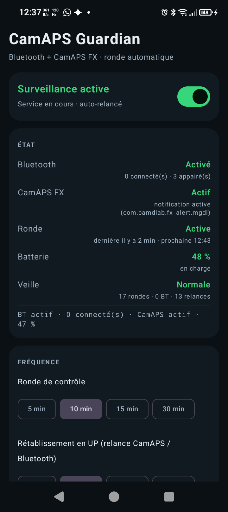
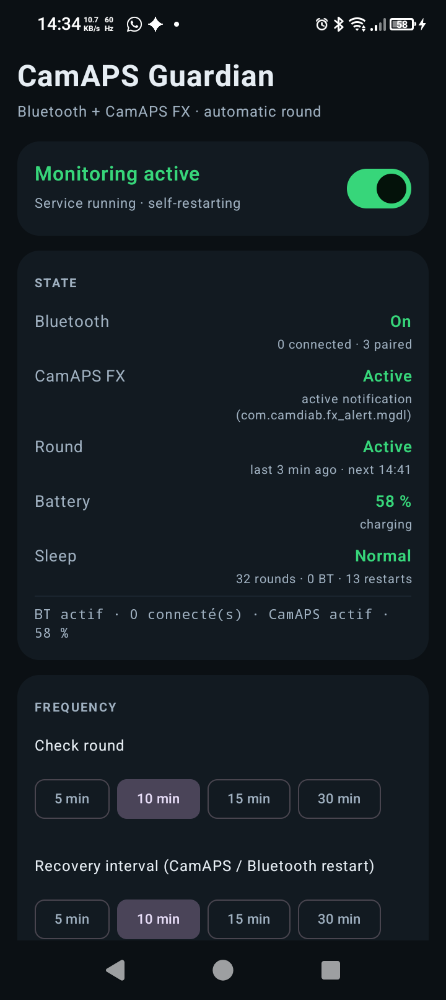

# CamAPS Guardian

🇫🇷 **Français** (cette page) · 🇬🇧 [**English**](#english)

**Un gardien de coin de rue pour CamAPS FX.** Une petite application Android qui vérifie, à
intervalle régulier, que le Bluetooth de votre téléphone est allumé et que CamAPS FX tourne
toujours — et qui tente de rétablir ce qui ne l'est plus.


**[⬇︎ Télécharger la dernière version](https://github.com/Najah69/camaps-guardian/releases/latest)**

---

## 🛑 À lire avant tout

> **CamAPS Guardian n'est pas un dispositif médical.**
>
> Il ne calcule aucune dose, ne commande pas la pompe, ne lit pas la glycémie et **ne remplace
> ni CamAPS FX, ni ses alarmes**. Il ne fait qu'une chose : essayer de maintenir en vie la
> liaison entre votre téléphone, votre capteur et l'application.
>
> **Gardez toutes les alarmes de CamAPS FX activées.** Ce sont elles — et elles seules — qui
> vous préviennent d'une perte de connexion ou d'une glycémie dangereuse. CamAPS Guardian est
> un filet supplémentaire, jamais le filet principal.
>
> Ce projet est fourni **tel quel**, sans aucune garantie, sous licence MIT. Il n'est ni édité,
> ni validé, ni soutenu par CamDiab Ltd. Si vous n'êtes pas à l'aise avec l'installation d'une
> application hors du Play Store, **faites-vous aider** : une erreur de manipulation sur un
> téléphone qui pilote une boucle fermée n'est pas anodine.

---

## Sommaire

**Partie 1 — pour les personnes diabétiques de type 1 sous CamAPS FX**
1. [En deux mots](#1-en-deux-mots)
2. [À qui s'adresse ce projet](#2-à-qui-sadresse-ce-projet)
3. [Pourquoi CamAPS FX peut s'arrêter](#3-pourquoi-camaps-fx-peut-sarrêter)
4. [Ce que fait CamAPS Guardian](#4-ce-que-fait-camaps-guardian)
5. [Ce qu'il ne fait pas](#5-ce-quil-ne-fait-pas)
6. [Ce qu'il faut sur votre téléphone](#6-ce-quil-faut-sur-votre-téléphone)
7. [Installation, pas à pas](#7-installation-pas-à-pas)
8. [Les réglages constructeur, souvent oubliés](#8-les-réglages-constructeur-souvent-oubliés)
9. [Comment savoir que ça marche](#9-comment-savoir-que-ça-marche)
10. [Les réglages, un par un](#10-les-réglages-un-par-un)
11. [Lire le journal](#11-lire-le-journal)
12. [Le rapport PDF](#12-le-rapport-pdf)
13. [Questions fréquentes](#13-questions-fréquentes)
14. [Vie privée](#14-vie-privée)
15. [Désinstallation](#15-désinstallation)

**Partie 2 — pour les développeurs**
16. [Architecture](#16-architecture)
17. [La stratégie de survie](#17-la-stratégie-de-survie)
18. [Pourquoi `targetSdk 32`](#18-pourquoi-targetsdk-32)
19. [Détecter CamAPS FX sans root](#19-détecter-camaps-fx-sans-root)
20. [Contrôler le Bluetooth en couches](#20-contrôler-le-bluetooth-en-couches)
21. [Compiler](#21-compiler)
22. [Carte du code](#22-carte-du-code)
23. [Ce qui est vérifié, ce qui ne l'est pas](#23-ce-qui-est-vérifié-ce-qui-ne-lest-pas)
24. [Contribuer](#24-contribuer)
25. [Licence](#25-licence)

---

# Partie 1 — pour les personnes diabétiques de type 1 sous CamAPS FX

## 1. En deux mots

CamAPS FX a besoin de deux choses pour faire son travail : **être lancé**, et **parler à votre
capteur en Bluetooth**. Android, de son côté, fait tout pour économiser la batterie : il endort
les applications, coupe les services, et parfois le Bluetooth décroche.

CamAPS Guardian est une application qui **reste éveillée** et qui, toutes les 5, 10, 15 ou
30 minutes selon votre choix, va voir :

- le Bluetooth est-il allumé ?
- un appareil est-il réellement connecté ?
- CamAPS FX tourne-t-il encore ?

Si quelque chose ne va pas, elle essaie de le remettre en route — et elle **écrit tout** dans un
journal que vous pouvez lire.

L'application est **bilingue** : elle s'affiche en français ou en anglais selon la langue du
téléphone. Sur Android 13 et plus, vous pouvez aussi choisir sa langue pour elle seule, dans
**Réglages ▸ Applications ▸ CamAPS Guardian ▸ Langue**.

## 2. À qui s'adresse ce projet

- Vous êtes **diabétique de type 1** et vous utilisez **CamAPS FX** sur un téléphone **Android**.
- Votre téléphone est celui qui porte la boucle fermée : il reste près de vous, jour et nuit.
- Il vous est déjà arrivé de retrouver CamAPS FX fermé, ou le Bluetooth éteint, sans savoir
  pourquoi ni depuis quand.

Si vous êtes sous CamAPS FX sur iPhone, ce projet ne vous concerne pas : il est écrit pour
Android uniquement.

## 3. Pourquoi CamAPS FX peut s'arrêter

Trois choses arrivent, et aucune n'est de votre faute :

**L'application est tuée.** Android ferme les applications en arrière-plan pour libérer de la
mémoire, ou parce qu'un fabricant a décidé d'être particulièrement agressif (Xiaomi, Huawei,
Samsung, Oppo, MediaTek en général). CamAPS FX disparaît alors sans bruit.

**Le Bluetooth s'éteint.** Une économie d'énergie, un redémarrage, une mise à jour, et le
Bluetooth n'est plus là. CamAPS FX ne peut plus joindre le capteur.

**La liaison décroche.** Le capteur et le téléphone se perdent de vue. CamAPS FX essaie de se
reconnecter tout seul — mais si l'application est en arrière-plan, Android peut l'en empêcher.

CamAPS FX a ses propres alarmes, et elles fonctionnent. CamAPS Guardian ne les remplace pas : il
ajoute une vérification **régulière et indépendante**, qui ne dépend pas de l'application
surveillée pour fonctionner.

## 4. Ce que fait CamAPS Guardian

À chaque ronde, dans cet ordre :

| Étape | Ce qui est vérifié | Ce qui est tenté |
|---|---|---|
| 1 | Le Bluetooth est-il allumé ? | Rallumage direct, puis via root ou Shizuku, sinon alerte à toucher |
| 2 | Combien d'appareils sont connectés ? | Si zéro pendant plusieurs rondes : CamAPS ramené au premier plan ; option : cycle Bluetooth (coupure puis rallumage) |
| 3 | CamAPS FX tourne-t-il ? | Si muet deux rondes de suite : relance par l'écran de lancement |
| 4 | Batterie et veille | Rien de destructeur : un rappel si la batterie descend sous 15 % |
| 5 | La chaîne d'alarmes tient-elle ? | Réarmement, réécriture de la notification permanente |

Chaque ronde est aussi notée dans un **historique** gardé 100 jours sur le téléphone : c'est
lui qui permet de produire, à la demande, un [rapport PDF](#12-le-rapport-pdf) avec camembert et
graphiques sur un jour, une semaine, un mois ou trois mois.

Elle continue **quoi qu'il arrive** : elle ne s'arrête jamais d'elle-même, même à 3 % de
batterie, même en veille prolongée, même après un redémarrage du téléphone.

## 5. Ce qu'il ne fait pas

Dire ce qu'un outil ne fait pas est aussi important que le reste.

- **Il ne dose pas l'insuline.** Il ne touche ni à la pompe, ni aux paramètres de CamAPS FX.
- **Il ne remplace pas les alarmes de CamAPS FX.** Gardez-les toutes activées.
- **Il n'est pas infaillible.** Aucune application Android ne peut être totalement
  increvable sans être installée comme application système (root) ou comme propriétaire de
  l'appareil. CamAPS Guardian fait le maximum de ce qui est possible sans privilège, et le
  journal dit honnêtement ce qui a fonctionné.
- **Sans root ni Shizuku, il ne peut pas rallumer le Bluetooth tout seul** sur Android 13 et
  plus : Android l'interdit aux applications ordinaires. Il affiche alors un écran d'alerte
  qu'il faut toucher. C'est une limite du système, pas un défaut de l'application.
- **Il ne détecte pas toujours CamAPS FX.** S'il n'a pas l'accès aux notifications et que
  CamAPS FX n'est pas passé au premier plan récemment, son état est « indéterminé » — et dans
  ce cas il ne relance rien, par prudence.
- **Il n'est pas publié sur le Play Store**, et ne peut pas l'être dans cet état (voir
  [§18](#18-pourquoi-targetsdk-32)). Vous l'installez à la main, en connaissance de cause.

## 6. Ce qu'il faut sur votre téléphone

- Android **8.0 ou plus récent**.
- **CamAPS FX installé et fonctionnel.**
- Le **débogage USB** n'est pas nécessaire : c'est juste plus pratique pour installer.
- Environ **8 Mo** d'espace libre.

Rien d'autre. Pas de compte, pas de connexion Internet, pas de serveur.

## 7. Installation, pas à pas

### 7.1 Récupérer l'application

Téléchargez [`app-release.apk`](https://github.com/Najah69/camaps-guardian/releases/latest)
depuis la page **Releases** de ce dépôt, ou compilez-la vous-même (voir [§21](#21-compiler)).

### 7.2 Autoriser l'installation depuis une source inconnue

Android bloque par défaut les applications qui ne viennent pas du Play Store. C'est une
protection normale ; vous l'ouvrez pour cette installation seulement.

1. Ouvrez le fichier `app-release.apk` depuis votre gestionnaire de fichiers.
2. Android propose « Ouvrir avec » ou affiche un message de blocage.
3. Touchez **Paramètres**, puis autorisez votre gestionnaire de fichiers (ou votre navigateur)
   à « installer des applications inconnues ».
4. Revenez en arrière et touchez **Installer**.

> Vous verrez peut-être « Application conçue pour une version plus ancienne d'Android ».
> C'est normal et volontaire : voir [§18](#18-pourquoi-targetsdk-32). Cela ne vous empêche pas
> de l'installer, et cela n'affecte pas son fonctionnement.

### 7.3 Accorder les autorisations

Ouvrez **CamAPS Guardian**. La section **AUTORISATIONS** de l'écran liste ce qui manque. Touchez
chaque ligne pour ouvrir le réglage Android correspondant :

| Autorisation | Pourquoi | Obligatoire ? |
|---|---|---|
| **Notifications** | Afficher la surveillance en cours et les alertes | Oui |
| **Bluetooth** | Lire l'état et les appareils connectés | Oui |
| **Batterie sans restriction** | Empêcher Android d'endormir la ronde | **Oui, la plus importante** |
| **Afficher par-dessus les autres applis** | Ramener CamAPS au premier plan sans que vous ayez à le faire | Fortement conseillé |
| **Accès aux notifications** | Savoir si CamAPS FX est vivant (sa notification permanente) | Fortement conseillé |
| **Alarmes exactes** | Déclencher la ronde à l'heure dite | Oui si proposé |
| **Accès aux stats d'usage** | Aide à dater le dernier passage au premier plan de CamAPS | Facultatif |

Ne sautez pas la ligne **Batterie sans restriction** : sans elle, votre téléphone finira par
endormir la ronde, et tout le reste devient inutile.

### 7.4 Activer la surveillance

Revenez sur l'écran principal et basculez l'interrupteur **Surveillance arrêtée** vers la
position active. Le libellé devient **Surveillance active**, et une notification permanente
apparaît dans la barre d'état : c'est le signe que le service tourne.

## 8. Les réglages constructeur, souvent oubliés

C'est la partie que presque tout le monde rate, et c'est celle qui décide si l'application
survivra à la nuit.

Chaque fabricant a sa propre couche d'économies d'énergie, **au-dessus** de celle d'Android.
Voici les noms à chercher dans les réglages de votre téléphone :

| Fabricant | À activer | À désactiver |
|---|---|---|
| **Xiaomi / Redmi / POCO** | « Démarrage automatique » pour CamAPS Guardian | « Économiseur de batterie » pour l'application |
| **Huawei / Honor** | « Lancer manuellement » / « Gérer manuellement » | Optimisation de l'application |
| **Samsung** | Retirer de « Applications en veille » | « Mettre l'application en veille » |
| **Oppo / Realme / OnePlus** | « Démarrage automatique » | « Optimisation de la batterie » |
| **Vivo** | « Démarrage en arrière-plan » | « Économie d'énergie élevée » |
| **MediaTek (dont Hammer, Ulefone)** | « Autostart » / « Démarrage auto » | « Veille en arrière-plan » |
| **Android nu (Pixel)** | Rien de spécial | Rien de spécial |

Le nom exact varie d'un modèle à l'autre. Cherchez dans les réglages les mots
**démarrage automatique**, **autostart**, **veille** ou **optimisation**.

> **Le test qui compte :** redémarrez votre téléphone, attendez deux minutes, puis ouvrez
> CamAPS Guardian. S'il affiche **Surveillance active** sans que vous ayez rien fait, votre
> configuration est bonne. Sinon, un réglage constructeur manque.

## 9. Comment savoir que ça marche

1. Ouvrez CamAPS Guardian.
2. Touchez **Vérifier maintenant** (section ACTIONS).
3. Lisez la ligne de résumé sous les boutons : elle doit ressembler à
   `BT actif · 2 connecté(s) · CamAPS actif · 78 %`.

Si elle affiche `CamAPS absent`, lisez [§13](#13-questions-fréquentes).



Puis laissez faire. Une ronde toutes les 10 minutes (par défaut) suffit à repérer un problème
sans vider la batterie.

## 10. Les réglages, un par un

### Fréquence

- **Ronde de contrôle** : `5 min`, `10 min`, `15 min`, `30 min`. C'est la fréquence à laquelle
  l'application regarde. **10 minutes** est un bon compromis pour un téléphone de boucle fermée.
  Descendez à 5 minutes si vous voulez être averti plus vite ; montez si la batterie souffre.
- **Rétablissement en UP** : la même échelle, mais pour les *relances*. Deux rondes consécutives
  peuvent détecter un problème ; cette limite évite de ramener CamAPS FX au premier plan toutes
  les deux minutes. **10 minutes** est un bon réglage.

### Interrupteurs

| Réglage | Effet | Conseil |
|---|---|---|
| **Rallumer le Bluetooth** | Tente de rallumer le Bluetooth s'il est éteint | Laissez activé |
| **Relancer CamAPS FX** | Ramène CamAPS au premier plan après deux rondes muettes | Laissez activé |
| **Relancer si connexion Bluetooth perdue** | Ramène CamAPS au premier plan quand aucun appareil n'est connecté — **seulement s'il est muet ou d'état inconnu** | Laissez activé |
| **Cycle Bluetooth agressif** | Coupe puis rallume le Bluetooth après 4 pertes de suite | À activer seulement si vous perdez souvent la liaison |

### Boutons

| Bouton | Ce qu'il fait |
|---|---|
| **Vérifier maintenant** | Lance une ronde immédiatement (sans attendre l'alarme) |
| **Relancer CamAPS** | Ramène CamAPS FX au premier plan tout de suite |
| **Détecter CamAPS FX** | Retrouve le nom de paquet de CamAPS FX et l'enregistre |
| **Effacer le journal** | Vide le journal (utile avant de signaler un problème) — l'historique des rapports n'est pas touché |
| **Exporter le journal (Téléchargements)** | Copie le journal complet dans `Téléchargements/camaps-guardian-journal-AAAAMMJJ-HHMMSS.txt` |
| **Générer le rapport PDF** | Dans le panneau **Rapport** : voir [§12](#12-le-rapport-pdf) |

## 11. Lire le journal

Le journal est la partie la plus utile de l'application : il dit **ce qui s'est passé, quand, et
pourquoi**. Chaque ligne commence par une heure et une catégorie.

```
18/10 10:19:38 [service] service démarré (Android 15 (API 35))
18/10 10:19:38 [ronde] contrôle — démarrage
18/10 10:19:38 [camaps] relance par intent direct (com.camdiab.fx_alert.mgdl)
18/10 10:19:38 [ronde] notes : CamAPS muet (1×) : aucune notification active
18/10 10:19:38 [ronde] BT actif · 0 connecté(s) · CamAPS muet · 44 % · CamAPS relancé
18/10 10:19:38 [alarme] prochaine ronde 10:29 (alarmClock, 10 min)
```

| Catégorie | Signification |
|---|---|
| `[app]` | Démarrage de l'interface |
| `[service]` | Le service de surveillance démarre, termine une ronde, se réarme |
| `[ronde]` | Le résultat d'une ronde : ce qui a été vu, ce qui a été fait |
| `[alarme]` | La prochaine ronde est programmée (ou la chaîne a été réparée) |
| `[camaps]` | CamAPS FX a été relancé, ou n'a pas pu l'être |
| `[notif]` | Accès aux notifications accordé ou perdu |
| `[shell]` | root / Shizuku : disponible ou non |
| `[boot]` | Le téléphone a redémarré, ou l'application a été mise à jour |
| `[système]` | Changement d'heure, mise en veille |
| `[événement]` | Branchement du chargeur, etc. |

L'écran n'en montre que les 40 dernières lignes. Pour lire le journal complet, touchez
**Exporter le journal (Téléchargements)** : le fichier texte apparaît dans le dossier
Téléchargements, d'où vous pouvez l'ouvrir, le partager ou le copier sur un ordinateur
(`adb pull /sdcard/Download/camaps-guardian-journal-…txt`). C'est le seul moyen : l'application
interdit les sauvegardes Android et `run-as` ne fonctionne pas sur une version signée.

## 12. Le rapport PDF

Le journal dit ce qui s'est passé ronde par ronde ; le **rapport** en fait la synthèse sur une
période, avec des graphiques lisibles par n'importe qui — vous, un proche, votre diabétologue.

**Comment l'obtenir.** Dans le panneau **Rapport**, choisissez la période puis touchez
**Générer le rapport PDF** :

| Choix | Période couverte | Graphique principal |
|---|---|---|
| **Jour** | les 24 dernières heures | heure par heure |
| **Semaine** | les 7 derniers jours, aujourd’hui compris | jour par jour |
| **Mois** | les 30 derniers jours | jour par jour |
| **3 mois** | les 13 dernières semaines | semaine par semaine |

Le fichier `camaps-guardian-rapport-<période>-AAAAMMJJ-HHMM.pdf` est enregistré dans
**Téléchargements** ; les boutons **Ouvrir** et **Partager** apparaissent juste en dessous.

**Ce qu'il contient (3 pages A4).**

1. **Synthèse** — quatre chiffres clés (part du temps où la liaison était correcte, coupures de
   30 minutes ou plus, plus longue coupure, part du temps réellement surveillé), un **camembert**
   de la répartition du temps entre les états ci-dessous, et une **analyse rédigée** : comparaison
   avec la période précédente de même durée, cause principale des coupures, heures où elles se
   concentrent, interventions de Guardian, batterie.
2. **Graphiques** — barres empilées par heure, jour ou semaine ; coupures selon l'heure de la
   journée (pour repérer, par exemple, un problème qui revient chaque nuit) ; courbe de la batterie.
3. **Détails** — tableau des interventions (rondes, Bluetooth rallumé, CamAPS relancé, cycles,
   redémarrages du téléphone, temps sous 15 % de batterie), les 15 plus longues coupures avec leur
   cause, et la méthode de calcul.

**Les états, et leur couleur.**

| État | Couleur | Ce que cela veut dire |
|---|---|---|
| Liaison correcte | vert | Bluetooth actif, au moins un appareil connecté, CamAPS FX actif |
| Aucun appareil BT connecté | jaune | Bluetooth actif mais rien de connecté : le plus souvent le capteur ou le transmetteur (portée, fin de vie) |
| CamAPS FX muet ou absent | orange | Aucune trace de vie de CamAPS FX pendant la ronde |
| Bluetooth éteint | rouge | Le Bluetooth était coupé |
| État incertain | gris | Une information manquait (autorisation absente, par exemple) |
| Non surveillé | gris clair | Plus de nouvelles de Guardian : téléphone éteint, surveillance arrêtée, rondes retardées |

Chaque état est supposé valable jusqu'à la ronde suivante, au plus deux rondes et demie (25 min
pour une ronde toutes les 10 min), et jamais au-delà d'un redémarrage du téléphone.

**À savoir.**

- **Il faut du recul.** L'historique commence à l'installation de la version 1.3 (plus ce que le
  journal contenait encore, soit un jour ou deux). Un rapport « 3 mois » demandé la première
  semaine le signale en tête et ne porte que sur les jours disponibles.
- **« Aucun appareil connecté » ne nomme pas le capteur.** Android dit combien d'appareils sont
  connectés, pas lesquels : une montre ou des écouteurs connectés peuvent masquer la perte du
  capteur. Seul CamAPS FX sait si *son* capteur répond.
- **Ce n'est pas un document médical.** Il ne contient aucune glycémie, aucune dose : seulement
  l'état de la liaison. Il complète les rapports de CamAPS FX, il ne les remplace pas.
- **Le rapport est à vous.** Il n'est créé que si vous le demandez, reste dans Téléchargements
  et ne part nulle part tant que vous ne le partagez pas. Il mentionne le modèle du téléphone.

## 13. Questions fréquentes

**« CamAPS FX introuvable »**
Le nom de paquet enregistré ne correspond pas. Touchez **Détecter CamAPS FX** : l'application
retrouve le bon nom et l'enregistre. (Sur beaucoup de téléphones, c'est
`com.camdiab.fx_alert.mgdl`.) L'application corrige aussi cette liste toute seule au démarrage.

**« CamAPS FX : Indéterminé »**
Elle ne peut pas savoir si CamAPS tourne. Accordez l'**accès aux notifications** (le plus
efficace) et, à défaut, l'**accès aux stats d'usage**. Tant que l'état est indéterminé, elle ne
relance rien : c'est volontaire.

**Une alerte « Le Bluetooth est éteint » apparaît**
Android 13 et plus interdit à une application ordinaire de rallumer le Bluetooth. Touchez
l'alerte : le Bluetooth se rallume. Pour que ce soit automatique, il faut **root** ou
**Shizuku** — voir [§20](#20-contrôler-le-bluetooth-en-couches).

**« 0 connecté(s) » alors que le capteur fonctionne**
Le capteur n'est pas connecté *à cet instant*. Cela arrive pendant une reconnexion. Ce qui
compte, c'est la tendance : si le compteur reste à zéro pendant des heures, le problème vient du
capteur ou du transmetteur, pas de l'application. Au bout de six rondes, elle vous le signale.

**La surveillance s'arrête après un redémarrage**
Un réglage constructeur bloque le démarrage automatique. Voir [§8](#8-les-réglages-constructeur-souvent-oubliés).

**Elle consomme de la batterie**
Une ronde toutes les 10 minutes coûte très peu. Si vous constatez une consommation anormale,
passez à 15 ou 30 minutes. Une batterie vide est un problème plus grave qu'une ronde en moins.

**Est-ce que ça marche sur mon téléphone ?**
Voir [§23](#23-ce-qui-est-vérifié-ce-qui-ne-lest-pas) : une seule marque a été testée
réellement. Les mécanismes utilisés sont standard, mais chaque surcouche constructeur a ses
surprises.

**Est-ce que je peux l'installer sur le téléphone qui porte la boucle fermée ?**
Oui — c'est même son usage prévu. Mais lisez [§5](#5-ce-quil-ne-fait-pas) d'abord, et gardez les
alarmes de CamAPS FX.

## 14. Vie privée

- **Aucune connexion Internet.** L'application ne demande même pas la permission réseau.
- **Aucune donnée envoyée nulle part.** Pas de compte, pas de télémétrie, pas de publicité.
- **Tout reste sur le téléphone** : les réglages dans les préférences Android, le journal et
  l'historique des rondes (100 jours) dans des fichiers privés de l'application.
- **Les fichiers exportés sont à vous.** Un journal exporté ou un rapport PDF n'est créé que si
  vous touchez le bouton correspondant. Il est alors placé dans Téléchargements, où d'autres
  applications ayant accès à vos fichiers peuvent le lire : supprimez-le quand vous n'en avez
  plus besoin.
- **Aucun accès à vos glycémies.** L'application ne lit ni l'historique de CamAPS FX, ni les
  données du capteur : elle se contente de vérifier que le Bluetooth est allumé, qu'un appareil
  est connecté, et que CamAPS FX a une notification à l'écran.

Le code est public : vous pouvez vérifier tout cela vous-même.

## 15. Désinstallation

1. Désactivez d'abord la surveillance (interrupteur **Surveillance active**). Cela annule les
   alarmes et la tâche planifiée.
2. Désinstallez l'application normalement, depuis les réglages Android.
3. Si vous aviez accordé l'accès aux notifications, il disparaît avec l'application.

**Ne désinstallez jamais CamAPS FX** pour « faire le ménage » : il contient l'historique de votre
boucle et sa configuration. CamAPS Guardian ne touche jamais à ses données.

---

# Partie 2 — pour les développeurs

## 16. Architecture

```
┌──────────────────────────────────────────────────────────────┐
│  Réveils                                                     │
│  AlarmManager.setAlarmClock()  ──┐                           │
│  Alarme de secours (+3 min)    ──┼──►  WakeReceiver          │
│  JobScheduler persistant 15 min ─┤        │                  │
│  Battement interne 60 s        ──┘        ▼                  │
│                                    WatchdogService (FGS)     │
│                                          │                   │
│                         ┌────────────────┼───────────────┐   │
│                         ▼                ▼               ▼   │
│                   BluetoothCtl      CamapsCtl        Sys     │
│                         │                │               │   │
│                         ▼                ▼               ▼   │
│                    état, appareils,  présence,      batterie, │
│                    rallumage, cycle   relance        veille   │
│                         │                │               │   │
│                         └────────────────┴───────────────┘   │
│                                          ▼                   │
│                                    Watchdog.check()          │
│                                          ▼                   │
│                             préférences + journal + notif.   │
└──────────────────────────────────────────────────────────────┘
```

Le service ne fait presque rien lui-même : il déclenche `Watchdog.check()`, qui prend toutes les
décisions et écrit tout. L'interface lit un `Snap` (photographie de l'état) exposé par un
`StateFlow` — elle ne pilote jamais la surveillance.

## 17. La stratégie de survie

Aucun de ces mécanismes ne suffit seul ; c'est leur empilement qui tient.

| Mécanisme | Rôle |
|---|---|
| Service de premier plan `connectedDevice\|specialUse` | Pas de limite de durée (contrairement à `dataSync` sur Android 15), notification permanente |
| `START_STICKY` + `stopWithTask="false"` | Survit au balayage depuis les récentes |
| `AlarmManager.setAlarmClock()` | **Traverse Doze** sans autorisation spéciale ; c'est la seule alarme dans ce cas |
| Alarme de secours à +3 min | Si la première est perdue |
| `JobScheduler` persistant (15 min) | Survit au redémarrage, rattrape les trous |
| Battement interne de 60 s | Détecte une chaîne d'alarmes cassée et la réarme |
| Réarmement dans `onDestroy` / `onTaskRemoved` | Replanifie une ronde une minute plus tard |
| `BOOT_COMPLETED`, `MY_PACKAGE_REPLACED`, `TIME_SET` | Réarme après redémarrage, mise à jour, changement d'heure |
| `PARTIAL_WAKE_LOCK` pendant la ronde | Le processeur ne se rendort pas au milieu du contrôle |
| `REQUEST_IGNORE_BATTERY_OPTIMIZATIONS` | Empêche l'optimisation agressive du constructeur |

Le détail du dimensionnement des alarmes est dans `core/Alarms.kt` : alarme principale
(`setAlarmClock`), repli `setExactAndAllowWhileIdle`, puis `setAndAllowWhileIdle`, et enfin un
`JobScheduler` persistant. Chaque échec est journalisé — on sait toujours quelle stratégie a
fonctionné.

## 18. Pourquoi `targetSdk 32`

`BluetoothAdapter.enable()` est déprécié et restreint : à partir d'Android 13 (API 33), une
application qui **cible** 33 ou plus ne peut plus activer le Bluetooth par programme. En ciblant
**32**, l'appel reste autorisé et Android n'affiche qu'un avertissement de compatibilité.

Conséquences assumées :

- L'application ne peut pas être publiée sur le Play Store (ce n'est pas le but).
- Android peut afficher « Application conçue pour une version plus ancienne ».
- **Ne relevez pas `targetSdk` sans accepter de perdre cette possibilité.**

Sur Android 15, en pratique, le refus est fréquent même en ciblant 32 : les replis
(root, Shizuku, alerte) ne sont pas décoratifs, ce sont souvent les seuls chemins qui marchent.

## 19. Détecter CamAPS FX sans root

Trois signaux indépendants, du plus fiable au plus faible :

1. **La notification permanente de CamAPS FX** (`NotificationListenerService.getActiveNotifications()`).
   C'est le meilleur indicateur : une application vivante qui suit un capteur publie une
   notification « en cours ».
2. **L'historique des arrêts du système** (`getHistoricalProcessExitReasons()`, API 30+) : dit si
   CamAPS FX a planté, a été tué pour mémoire, ou a déclenché un ANR. La fenêtre est limitée à
   **20 minutes** : au-delà, un arrêt ancien n'a plus de sens.
3. **Le dernier passage au premier plan** (`UsageStatsManager.queryEvents()` +
   `ACTIVITY_RESUMED`) : utile seulement si l'accès aux stats d'usage est accordé.

Si aucun signal n'est disponible, l'état est **`UNKNOWN`** et aucune relance n'est tentée : mieux
vaut ne rien faire que ramener au premier plan une application qui tournait peut-être très bien.

La relance se fait par l'**intent de lancement** (`NEW_TASK | RESET_TASK_IF_NEEDED |
REORDER_TO_FRONT`), avec un repli `monkey -p <pkg> -c android.intent.category.LAUNCHER 1`.
**Jamais de `force-stop`, jamais de `pm clear`** : ce serait détruire la boucle pour la « réparer ».

## 20. Contrôler le Bluetooth en couches

```
1. BluetoothAdapter.enable()                  → direct, si le système l'autorise
2. su -c "cmd bluetooth_manager enable"       → root
3. su -c "svc bluetooth enable"               → root, autre chemin
4. Shizuku.newProcess(...)                    → root délégué, sans root système
5. ActionActivity (plein écran)               → l'utilisateur touche, ça se rallume
```

Shizuku est appelé **par réflexion** (`rikka.shizuku.Shizuku`) : aucune dépendance, aucune
compilation croisée. Si Shizuku n'est pas installé, l'appel échoue proprement et on passe à
l'étape suivante.

L'alerte plein écran utilise `USE_FULL_SCREEN_INTENT` et `SYSTEM_ALERT_WINDOW`, ce qui permet
aussi de démarrer une activité depuis l'arrière-plan (`Background activity start ... allowed
because SYSTEM_ALERT_WINDOW permission is granted`, visible dans logcat).

## 21. Compiler

Prérequis : **JDK 17** (ou plus récent pour lancer Gradle) et le **SDK Android** avec
`compileSdk 36`.

```bash
git clone https://github.com/Najah69/camaps-guardian.git
cd camaps-guardian
echo "sdk.dir=/chemin/vers/Android/Sdk" > local.properties   # ou définir ANDROID_HOME

./gradlew :app:assembleRelease        # Linux / macOS
gradlew.bat :app:assembleRelease      # Windows
```

L'APK est écrit dans `app/build/outputs/apk/release/app-release.apk` (environ 8 Mo).

### Signature

Le dépôt **ne contient aucune clé**. Sans `keystore.properties`, Gradle signe avec la clé de
débogage — l'APK s'installe, mais il ne pourra pas remplacer une version déjà signée avec une
autre clé. Pour signer avec votre propre clé :

```bash
keytool -genkeypair -v -keystore guardian.jks -keyalg RSA -keysize 4096 \
        -validity 10000 -alias guardian
```

Puis créez `keystore.properties` à la racine :

```properties
storeFile=guardian.jks
storePassword=...
keyAlias=guardian
keyPassword=...
```

`guardian.jks` et `keystore.properties` sont dans le `.gitignore` : **ne les publiez jamais**.
Une clé de signature perdue ou divulguée n'est pas récupérable.

## 22. Carte du code

```
app/src/main/java/com/najah/camapsguardian/
├── GuardianApp.kt           Initialisation (canaux, préférences)
├── ActionActivity.kt        Écran d'alerte plein écran (Bluetooth, permissions)
├── core/
│   ├── Prefs.kt             Réglages persistants + StateFlow
│   ├── I18n.kt              Traduction (français / anglais)
│   ├── Fmt.kt               Formatage des heures et des durées
│   ├── Logbook.kt           Journal (600 lignes, rotation automatique)
│   ├── Sys.kt               Batterie, Doze, autorisations spéciales
│   ├── Shell.kt             root / Shizuku (réflexion, sans dépendance)
│   ├── BluetoothCtl.kt      État, appareils connectés, rallumage, cycle
│   ├── CamapsCtl.kt         Présence de CamAPS FX, historique des arrêts, relance
│   ├── PresenceListener.kt  NotificationListenerService
│   ├── Notifier.kt          Canaux, notification permanente, alertes plein écran
│   ├── Alarms.kt            Chaîne d'alarmes (alarmClock + secours + JobScheduler)
│   ├── Watchdog.kt          La ronde : décisions et réparations
│   ├── WatchdogService.kt   Service de premier plan, battement de cœur
│   ├── WakeJobService.kt    Tâche périodique persistante
│   ├── Receivers.kt         Réveil, démarrage, changement d'heure
│   ├── Control.kt           Actions de haut niveau (activer, intervalle, vérifier)
│   ├── Status.kt            Photographie de l'état pour l'interface
│   ├── History.kt           Historique structuré des rondes (100 jours) + import du journal
│   ├── Report.kt            Analyse : états, coupures, cases horaires, comparaison
│   ├── ReportPdf.kt         Rendu PDF par le Canvas d'Android (aucune bibliothèque)
│   └── Downloads.kt         Écriture dans Téléchargements (MediaStore)
└── ui/                      MainActivity, écran Compose, thème
```

### Historique et rapport

Le journal texte ne suffit pas pour des statistiques : il tourne à 150 Ko (un ou deux jours) et sa
langue suit celle du téléphone. `History` garde donc à part, dans `files/history.csv`, une ligne
par ronde et par événement :

```
R;1792656000000;1;1;ALIVE;44;0;          ronde : bt, appareils, présence, batterie, secteur, drapeaux
R;1792656600000;1;0;NOT_ALIVE;43;0;L     drapeaux : B rallumé, U accord demandé, L relance, C cycle, M manuelle
E;1792657000000;BOOT                     événement : BOOT, ON, OFF
```

Environ 1 Mo pour 90 jours de rondes toutes les 10 minutes ; les lignes de plus de 100 jours sont
élaguées. À la première ouverture, `JournalImport` relit les bilans de ronde du journal existant
(en français ou en anglais) pour que le premier rapport ne parte pas de zéro.

`Report.analyze()` découpe la période en intervalles (chaque ronde vaut jusqu'à la suivante, au
plus 2,5 rondes, coupée par un `BOOT`), les classe par état, les ventile dans les cases du
graphique et par heure de la journée, et regroupe les intervalles problématiques consécutifs en
coupures. `ReportPdf` dessine trois pages A4 avec `android.graphics.pdf.PdfDocument` : pas de
dépendance, pas de réseau, et les couleurs d'état sont toujours accompagnées de leur libellé et
de leur pourcentage.

Pile technique : Kotlin 2.3, Jetpack Compose (BOM 2026.03.01), AGP 9.0.1, Gradle 9.1,
`minSdk 26`, `compileSdk 36`, `targetSdk 32`, `jvmToolchain(17)`.

## 23. Ce qui est vérifié, ce qui ne l'est pas

**Vérifié sur un appareil réel** — Hammer Iron 6 5G, Android 15 (API 35), sans root ni Shizuku :

- [x] Service de premier plan actif (`isForeground=true`, `types=0x40000010`)
- [x] Alarmes `RTC_WAKEUP` exactes avec `showIntent` (`setAlarmClock`, `exactAllowReason=permission`)
- [x] Tâche `JobScheduler` persistante enregistrée
- [x] Ronde manuelle : détection du Bluetooth, des appareils connectés et de CamAPS FX
- [x] Détection de CamAPS FX par sa notification permanente
- [x] Balayage depuis les récentes : le service survit et replanifie une ronde
- [x] **Redémarrage complet** : `BOOT_COMPLETED` → service démarré → CamAPS FX relancé → alarme reprogrammée
- [x] Repli par alerte plein écran quand le Bluetooth ne peut pas être rallumé
- [x] Absence de relance intempestive quand CamAPS FX est déjà vivant
- [x] Affichage **français** puis **anglais** de l'interface, après bascule de la langue de
      l'application : en-tête, état, fréquences, autorisations, actions, journal, note de bas de page
- [x] **Export du journal** (1.2) dans Téléchargements, puis récupération par `adb pull`
- [x] **Version 1.3** installée par-dessus la 1.2 (`adb install -r`) : données gardées, service de
      premier plan toujours actif
- [x] **Rapport PDF** généré pour les quatre périodes et relu page par page : chiffres conformes au
      journal (coupure de 6 h 43 retrouvée à la minute près), import du journal existant
      (199 bilans de ronde sur 199 reconnus)
- [x] Rapport **en anglais** après bascule de la langue de l'application, et boutons **Ouvrir**
      (choix de la liseuse PDF) et **Partager** (feuille de partage Android)

**Non vérifié, et signalé comme tel** :

- [ ] Autres fabricants (Xiaomi, Samsung, Huawei, Oppo, Pixel…) — mécanismes standard, mais
      surcouches différentes
- [ ] Rallumage du Bluetooth par root ou Shizuku (aucun de ces accès n'existait sur le téléphone de test)
- [ ] Comportement sur plusieurs semaines (fuite mémoire, dérive de la batterie)
- [ ] Mode Doze profond sur une nuit complète
- [ ] Android 8 à 14 (seul Android 15 a été utilisé)
- [ ] Rapport sur trois mois **réels** : l'historique de test ne couvre encore que quelques jours

Si vous testez sur un autre appareil, un retour dans les *Issues* a de la valeur — surtout s'il
est négatif.

## 24. Contribuer

Les retours sont bienvenus, en particulier :

- un rapport de test sur un autre fabricant (modèle, version d'Android, ce qui a marché) ;
- un journal (`[ronde]`, `[alarme]`) montrant un cas où la surveillance n'a pas repris ;
- une correction de traduction ou de formulation, si un passage n'est pas clair.

Merci de **ne pas joindre** de capture contenant vos glycémies, votre nom, ou des données de
santé : un extrait du journal de CamAPS Guardian suffit toujours.

## 25. Licence

MIT — voir [LICENSE](LICENSE). Faites-en ce que vous voulez, y compris commercialement, sans
garantie d'aucune sorte.

---

# English

🇬🇧 **English** (this section) · 🇫🇷 [**Français**](#camaps-guardian)

**A street-corner keeper for CamAPS FX.** A small Android app that regularly checks whether your
phone's Bluetooth is on and whether CamAPS FX is still running — and tries to restore whatever no
longer is.

**[⬇︎ Download the latest version](https://github.com/Najah69/camaps-guardian/releases/latest)**

## 🛑 Read this first

> **CamAPS Guardian is not a medical device.**
>
> It does not compute any dose, does not command the pump, does not read your glucose and **does not
> replace CamAPS FX or its alarms**. It does one thing only: try to keep alive the link between your
> phone, your sensor and the app.
>
> **Keep every CamAPS FX alarm enabled.** Those alarms — and only those — warn you about a lost
> connection or a dangerous glucose level. CamAPS Guardian is an extra net, never the main net.
>
> This project is provided **as is**, with no warranty of any kind, under the MIT licence. It is not
> edited, endorsed or supported by CamDiab Ltd. If you are not comfortable installing an app from
> outside the Play Store, **get someone to help you**: a mistake on a phone that drives a
> closed loop is not a trivial thing.

## Contents

**Part 1 — for people with type 1 diabetes using CamAPS FX**
1. [In a nutshell](#1-in-a-nutshell)
2. [Who this project is for](#2-who-this-project-is-for)
3. [Why CamAPS FX can stop](#3-why-camaps-fx-can-stop)
4. [What CamAPS Guardian does](#4-what-camaps-guardian-does)
5. [What it does not do](#5-what-it-does-not-do)
6. [What you need on your phone](#6-what-you-need-on-your-phone)
7. [Installation, step by step](#7-installation-step-by-step)
8. [The manufacturer settings everyone forgets](#8-the-manufacturer-settings-everyone-forgets)
9. [How to know it is working](#9-how-to-know-it-is-working)
10. [The settings, one by one](#10-the-settings-one-by-one)
11. [Reading the log](#11-reading-the-log)
12. [The PDF report](#12-the-pdf-report)
13. [FAQ](#13-faq)
14. [Privacy](#14-privacy)
15. [Uninstalling](#15-uninstalling)

**Part 2 — for developers**
16. [Architecture overview](#16-architecture-overview)
17. [The survival strategy](#17-the-survival-strategy)
18. [Why `targetSdk 32`](#18-why-targetsdk-32)
19. [Detecting CamAPS FX without root](#19-detecting-camaps-fx-without-root)
20. [Controlling Bluetooth in layers](#20-controlling-bluetooth-in-layers)
21. [Building](#21-building)
22. [Code map](#22-code-map)
23. [What is verified, what is not](#23-what-is-verified-what-is-not)
24. [Contributing](#24-contributing)
25. [License](#25-license)

---

# Part 1 — for people with type 1 diabetes using CamAPS FX

## 1. In a nutshell

CamAPS FX needs two things to do its job: **to be running**, and **to talk to your sensor over
Bluetooth**. Android, on the other hand, does everything it can to save battery: it puts apps to
sleep, stops services, and sometimes Bluetooth drops off.

CamAPS Guardian is an app that **stays awake** and that, every 5, 10, 15 or 30 minutes depending on
your choice, goes and looks:

- is Bluetooth on?
- is a device actually connected?
- is CamAPS FX still running?

If something is wrong, it tries to put it back on its feet — and it **writes everything** into a log
you can read.

The app is **bilingual**: it displays in French or in English depending on the phone's language. On
Android 13 and above you can also pick its language for the app alone, in
**Settings ▸ Apps ▸ CamAPS Guardian ▸ Language**.

## 2. Who this project is for

- You have **type 1 diabetes** and you use **CamAPS FX** on an **Android** phone.
- Your phone is the one carrying the closed loop: it stays near you, day and night.
- You have already found CamAPS FX closed, or Bluetooth off, without knowing why or for how long.

If you run CamAPS FX on an iPhone, this project is not for you: it is written for Android only.

## 3. Why CamAPS FX can stop

Three things happen, and none of them is your fault:

**The app is killed.** Android closes background apps to free memory, or because a manufacturer
decided to be particularly aggressive (Xiaomi, Huawei, Samsung, Oppo, MediaTek in general). CamAPS FX
then disappears silently.

**Bluetooth turns off.** A power saving tweak, a reboot, an update, and Bluetooth is gone. CamAPS FX
can no longer reach the sensor.

**The link drops.** Sensor and phone lose sight of each other. CamAPS FX tries to reconnect on its
own — but if the app is in the background, Android may prevent it from doing so.

CamAPS FX has its own alarms, and they work. CamAPS Guardian does not replace them: it adds a
**regular and independent** check, one that does not depend on the watched app to run.

## 4. What CamAPS Guardian does

On every round, in this order:

| Step | What is checked | What is attempted |
|---|---|---|
| 1 | Is Bluetooth on? | Direct re-enable, then through root or Shizuku, otherwise an alert to tap |
| 2 | How many devices are connected? | If zero for several rounds: CamAPS brought back to the foreground; optionally a Bluetooth cycle (off then on again) |
| 3 | Is CamAPS FX running? | If silent two rounds in a row: restart through its launch screen |
| 4 | Battery and sleep | Nothing destructive: a reminder if the battery drops below 15 % |
| 5 | Is the alarm chain still intact? | Re-arming, rewriting the ongoing notification |

Each round is also recorded in a **history** kept for 100 days on the phone: that is what lets
you produce, on request, a [PDF report](#12-the-pdf-report) with a pie chart and graphs over a day,
a week, a month or three months.

It keeps going **whatever happens**: it never stops on its own, not at 3 % battery, not in deep
sleep, not after a phone reboot.

## 5. What it does not do

Saying what a tool does not do matters as much as the rest.

- **It does not dose insulin.** It touches neither the pump nor CamAPS FX settings.
- **It does not replace CamAPS FX alarms.** Keep them all enabled.
- **It is not infallible.** No Android app can be truly unkillable without being installed as a
  system app (root) or as a device owner. CamAPS Guardian does the most that is possible without
  privileges, and the log honestly says what worked.
- **Without root or Shizuku it cannot turn Bluetooth back on by itself** on Android 13 and above:
  Android forbids that to ordinary apps. It then shows an alert screen you have to tap. That is a
  limit of the system, not a flaw of the app.
- **It does not always detect CamAPS FX.** If it has no notification access and CamAPS FX has not
  come to the foreground recently, its state is “unknown” — and in that case it restarts nothing, out
  of caution.
- **It is not published on the Play Store**, and cannot be in this state (see
  [§18](#18-why-targetsdk-32)). You install it by hand, knowingly.

## 6. What you need on your phone

- Android **8.0 or more recent**.
- **CamAPS FX installed and working.**
- **USB debugging** is not required: it is just more convenient for installing.
- About **8 MB** of free space.

Nothing else. No account, no internet connection, no server.

## 7. Installation, step by step

### 7.1 Get the app

Download [`app-release.apk`](https://github.com/Najah69/camaps-guardian/releases/latest) from the
**Releases** page of this repository, or build it yourself (see [§21](#21-building)).

### 7.2 Allow installation from an unknown source

Android blocks apps that do not come from the Play Store by default. That is normal protection; you
open it for this installation only.

1. Open the `app-release.apk` file from your file manager.
2. Android offers “Open with” or shows a blocking message.
3. Tap **Settings**, then allow your file manager (or your browser) to “install unknown apps”.
4. Go back and tap **Install**.

> You may see “App designed for an older version of Android”. That is normal and deliberate: see
> [§18](#18-why-targetsdk-32). It does not prevent you from installing it, and does not affect how it
> works.

### 7.3 Grant the permissions

Open **CamAPS Guardian**. The **PERMISSIONS** section of the screen lists what is missing. Tap each
line to open the matching Android setting:

| Permission | Why | Required? |
|---|---|---|
| **Notifications** | Show the ongoing monitoring and the alerts | Yes |
| **Bluetooth** | Read the state and the connected devices | Yes |
| **Unrestricted battery** | Stop Android from putting the round to sleep | **Yes, the most important one** |
| **Display over other apps** | Bring CamAPS back to the foreground without you having to do it | Strongly advised |
| **Notification access** | Know whether CamAPS FX is alive (its ongoing notification) | Strongly advised |
| **Exact alarms** | Fire the round at the right time | Yes when offered |
| **Usage access** | Helps date the last time CamAPS came to the foreground | Optional |

Do not skip the **Unrestricted battery** line: without it, your phone will eventually put the round
to sleep, and everything else becomes pointless.

### 7.4 Turn monitoring on

Go back to the main screen and flip the **Monitoring stopped** switch to the active position. The
label becomes **Monitoring active**, and an ongoing notification appears in the status bar: that is
the sign that the service is running.

## 8. The manufacturer settings everyone forgets

This is the part almost everybody misses, and it is the part that decides whether the app will
survive the night.

Every manufacturer has its own layer of power saving, **on top of** Android's. Here are the names to
look for in your phone's settings:

| Manufacturer | Turn on | Turn off |
|---|---|---|
| **Xiaomi / Redmi / POCO** | “Autostart” for CamAPS Guardian | “Battery saver” for the app |
| **Huawei / Honor** | “Launch manually” / “Manage manually” | App optimisation |
| **Samsung** | Remove from “Sleeping apps” | “Put the app to sleep” |
| **Oppo / Realme / OnePlus** | “Autostart” | “Battery optimisation” |
| **Vivo** | “Background start” | “High power saving” |
| **MediaTek (including Hammer, Ulefone)** | “Autostart” | “Background sleep” |
| **Stock Android (Pixel)** | Nothing special | Nothing special |

The exact name varies from one model to another. Look in the settings for the words **autostart**,
**auto-start**, **sleep** or **optimisation**.

> **The test that matters:** reboot your phone, wait two minutes, then open CamAPS Guardian. If it
> shows **Monitoring active** without you doing anything, your setup is good. If not, a manufacturer
> setting is missing.

## 9. How to know it is working

1. Open CamAPS Guardian.
2. Tap **Check now** (ACTIONS section).
3. Read the summary line under the buttons: it should look like
   `BT on · 2 connected · CamAPS active · 78 %`.

If it shows `CamAPS silent`, read the [FAQ](#13-faq).



Then let it do its job. One round every 10 minutes (the default) is enough to spot a problem without
draining the battery.

## 10. The settings, one by one

### Frequency

- **Check round**: `5 min`, `10 min`, `15 min`, `30 min`. That is how often the app looks.
  **10 minutes** is a good compromise for a closed-loop phone. Go down to 5 minutes if you want to be
  warned sooner; go up if the battery suffers.
- **Recovery interval**: the same scale, but for *restarts*. Two consecutive rounds may detect a
  problem; this limit avoids bringing CamAPS FX back to the foreground every two minutes.
  **10 minutes** is a good setting.

### Switches

| Setting | Effect | Advice |
|---|---|---|
| **Turn Bluetooth back on** | Tries to turn Bluetooth back on when it is off | Leave it on |
| **Restart CamAPS FX** | Brings CamAPS back to the foreground after two silent rounds | Leave it on |
| **Restart when the Bluetooth link is lost** | Brings CamAPS back to the foreground when no device is connected — **only if it is silent or of unknown state** | Leave it on |
| **Aggressive Bluetooth cycle** | Turns Bluetooth off then on again after 4 losses in a row | Only turn on if you often lose the link |

### Buttons

| Button | What it does |
|---|---|
| **Check now** | Runs a round immediately (without waiting for the alarm) |
| **Restart CamAPS** | Brings CamAPS FX back to the foreground right away |
| **Detect CamAPS FX** | Finds CamAPS FX's package name and saves it |
| **Clear log** | Empties the log (useful before reporting a problem) — the report history is not touched |
| **Export log (Downloads)** | Copies the full log to `Download/camaps-guardian-journal-YYYYMMDD-HHMMSS.txt` |
| **Create PDF report** | In the **Report** panel: see [§12](#12-the-pdf-report) |

## 11. Reading the log

The log is the most useful part of the app: it says **what happened, when, and why**. Every line
starts with a time and a category.

```
18/10 10:19:38 [service] service started (Android 15 (API 35))
18/10 10:19:38 [round] check — start
18/10 10:19:38 [camaps] restart by direct intent (com.camdiab.fx_alert.mgdl)
18/10 10:19:38 [round] notes: CamAPS silent (1×): no active notification
18/10 10:19:38 [round] BT on · 0 connected · CamAPS silent · 44 % · CamAPS restarted
18/10 10:19:38 [alarm] next round 10:29 (alarmClock, 10 min)
```

| Category | Meaning |
|---|---|
| `[app]` | The interface starts |
| `[service]` | The monitoring service starts, finishes a round, re-arms itself |
| `[round]` | The result of a round: what was seen, what was done |
| `[alarm]` | The next round is scheduled (or the chain was repaired) |
| `[camaps]` | CamAPS FX was restarted, or could not be |
| `[notif]` | Notification access granted or lost |
| `[shell]` | root / Shizuku: available or not |
| `[boot]` | The phone rebooted, or the app was updated |
| `[system]` | Time change, doze |
| `[event]` | Charger plugged in, etc. |

The screen only shows its last 40 lines. To read the full log, tap **Export log (Downloads)**:
the text file appears in the Downloads folder, from where you can open it, share it or copy it to
a computer (`adb pull /sdcard/Download/camaps-guardian-journal-…txt`). That is the only way: the
app forbids Android backups and `run-as` does not work on a signed build.

## 12. The PDF report

The log says what happened round by round; the **report** sums up a period, with charts anyone
can read — you, a relative, your diabetes team.

**How to get it.** In the **Report** panel, pick the period and tap **Create PDF report**:

| Choice | Period covered | Main chart |
|---|---|---|
| **Day** | the last 24 hours | hour by hour |
| **Week** | the last 7 days, today included | day by day |
| **Month** | the last 30 days | day by day |
| **3 months** | the last 13 weeks | week by week |

The file `camaps-guardian-rapport-<period>-YYYYMMDD-HHMM.pdf` is saved to **Downloads**; the
**Open** and **Share** buttons appear right below.

**What it contains (3 A4 pages).**

1. **Summary** — four key figures (share of time with the link OK, outages of 30 minutes or more,
   longest outage, share of time actually monitored), a **pie chart** of how time splits between
   the states below, and a **written analysis**: comparison with the previous period of the same
   length, main cause of outages, hours when they cluster, Guardian's interventions, battery.
2. **Charts** — stacked bars by hour, day or week; outages by time of day (to spot, say, a problem
   that comes back every night); battery curve.
3. **Details** — table of interventions (rounds, Bluetooth turned back on, CamAPS restarted,
   cycles, phone restarts, time below 15 % battery), the 15 longest outages with their cause, and
   the calculation method.

**The states, and their colour.**

| State | Colour | What it means |
|---|---|---|
| Link OK | green | Bluetooth on, at least one device connected, CamAPS FX active |
| No BT device connected | yellow | Bluetooth on but nothing connected: most often the sensor or transmitter (range, end of life) |
| CamAPS FX silent or absent | orange | No sign of life from CamAPS FX during the round |
| Bluetooth off | red | Bluetooth was switched off |
| Uncertain state | grey | Some information was missing (a permission not granted, for example) |
| Not monitored | light grey | No news from Guardian: phone off, monitoring stopped, rounds delayed |

Each state is assumed to hold until the next round, for at most two and a half rounds (25 min with
a round every 10 min), and never past a phone restart.

**Good to know.**

- **It needs time.** History starts when version 1.3 is installed (plus whatever the log still
  held, a day or two). A "3 months" report asked for in the first week says so at the top and only
  covers the days available.
- **"No device connected" does not name the sensor.** Android says how many devices are
  connected, not which ones: a connected watch or earbuds can hide a sensor loss. Only CamAPS FX
  knows whether *its* sensor answers.
- **It is not a medical document.** It contains no glucose value and no dose: only the state of
  the link. It complements CamAPS FX's own reports, it does not replace them.
- **The report is yours.** It is only created when you ask, stays in Downloads and goes nowhere
  until you share it. It mentions the phone model.

## 13. FAQ

**“CamAPS FX not found”**
The saved package name does not match. Tap **Detect CamAPS FX**: the app finds the right name and
saves it. (On many phones it is `com.camdiab.fx_alert.mgdl`.) The app also corrects that list by
itself on startup.

**“CamAPS FX: Unknown”**
It cannot tell whether CamAPS is running. Grant **notification access** (the most effective) and,
failing that, **usage access**. As long as the state is unknown it restarts nothing: that is
deliberate.

**A “Bluetooth is off” alert appears**
Android 13 and above forbids an ordinary app from turning Bluetooth back on. Tap the alert:
Bluetooth comes back on. To make that automatic you need **root** or **Shizuku** — see
[§20](#20-controlling-bluetooth-in-layers).

**“0 connected” while the sensor works**
The sensor is not connected *at that instant*. That happens during a reconnection. What matters is
the trend: if the counter stays at zero for hours, the problem is the sensor or the transmitter, not
the app. After six rounds it tells you so.

**Monitoring stops after a reboot**
A manufacturer setting blocks autostart. See
[§8](#8-the-manufacturer-settings-everyone-forgets).

**It uses battery**
One round every 10 minutes costs very little. If you notice unusual consumption, go to 15 or 30
minutes. An empty battery is a more serious problem than one round fewer.

**Does it work on my phone?**
See [§23](#23-what-is-verified-what-is-not): only one brand has actually been tested. The mechanisms
used are standard, but every manufacturer layer has its surprises.

**Can I install it on the phone that carries the closed loop?**
Yes — that is even its intended use. But read [§5](#5-what-it-does-not-do) first, and keep the CamAPS
FX alarms.

## 14. Privacy

- **No internet connection.** The app does not even ask for the network permission.
- **No data sent anywhere.** No account, no telemetry, no advertising.
- **Everything stays on the phone**: the settings in Android preferences, the log and the round
  history (100 days) in the app's private files.
- **Exported files are yours.** An exported log or a PDF report is only created when you tap the
  matching button. It is then placed in Downloads, where other apps with access to your files can
  read it: delete it when you no longer need it.
- **No access to your glucose values.** The app reads neither CamAPS FX history nor sensor data: it
  only checks that Bluetooth is on, that a device is connected, and that CamAPS FX has a notification
  on screen.

The code is public: you can check all of that yourself.

## 15. Uninstalling

1. First turn monitoring off (the **Monitoring active** switch). That cancels the alarms and the
   scheduled job.
2. Uninstall the app normally, from the Android settings.
3. If you had granted notification access, it disappears with the app.

**Never uninstall CamAPS FX** to “clean up”: it holds your loop's history and its configuration.
CamAPS Guardian never touches its data.

---

# Part 2 — for developers

## 16. Architecture overview

```
Wake-ups
  AlarmManager.setAlarmClock()  ──┐
  Backup alarm (+3 min)         ──┼──►  WakeReceiver
  Persistent JobScheduler 15 min ─┤          │
  Internal heartbeat 60 s       ──┘          ▼
                                     WatchdogService (foreground service)
                                               │
                       ┌───────────────────────┼───────────────────┐
                       ▼                       ▼                   ▼
                 BluetoothCtl             CamapsCtl             Sys
                       │                       │                   │
                       ▼                       ▼                   ▼
                state, devices,           presence,            battery,
                enable, cycle             relaunch             doze
                       │                       │                   │
                       └───────────────────────┴───────────────────┘
                                               ▼
                                       Watchdog.check()
                                               ▼
                              preferences + log + notification
```

The service does almost nothing itself: it triggers `Watchdog.check()`, which makes every decision
and writes everything down. The UI reads a `Snap` (a snapshot of the state) exposed through a
`StateFlow` — it never drives the monitoring.

## 17. The survival strategy

None of these mechanisms is enough on its own; it is their stacking that holds.

| Mechanism | Role |
|---|---|
| `connectedDevice\|specialUse` foreground service | No duration limit (unlike `dataSync` on Android 15), ongoing notification |
| `START_STICKY` + `stopWithTask="false"` | Survives being swiped away from recents |
| `AlarmManager.setAlarmClock()` | **Goes through Doze** without any special permission; it is the only alarm that does |
| Backup alarm at +3 min | In case the first one is lost |
| Persistent `JobScheduler` (15 min) | Survives a reboot, fills the gaps |
| Internal 60 s heartbeat | Detects a broken alarm chain and re-arms it |
| Re-arming in `onDestroy` / `onTaskRemoved` | Schedules a round one minute later |
| `BOOT_COMPLETED`, `MY_PACKAGE_REPLACED`, `TIME_SET` | Re-arms after a reboot, an update, a time change |
| `PARTIAL_WAKE_LOCK` during the round | The CPU does not fall asleep in the middle of the check |
| `REQUEST_IGNORE_BATTERY_OPTIMIZATIONS` | Prevents the manufacturer's aggressive optimisation |

The details of how the alarms are sized are in `core/Alarms.kt`: primary alarm (`setAlarmClock`),
`setExactAndAllowWhileIdle` fallback, then `setAndAllowWhileIdle`, and finally a persistent
`JobScheduler`. Every failure is logged — you always know which strategy worked.

## 18. Why `targetSdk 32`

`BluetoothAdapter.enable()` is deprecated and restricted: from Android 13 (API 33) on, an app that
**targets** 33 or more can no longer enable Bluetooth programmatically. By targeting **32**, the call
stays allowed and Android only shows a compatibility warning.

Accepted consequences:

- The app cannot be published on the Play Store (that is not the goal).
- Android may display “App designed for an older version of Android”.
- **Do not raise `targetSdk` without accepting to lose that possibility.**

On Android 15, in practice, the refusal is frequent even when targeting 32: the fallbacks (root,
Shizuku, alert) are not decorative, they are often the only paths that work.

## 19. Detecting CamAPS FX without root

Three independent signals, from the most reliable to the weakest:

1. **CamAPS FX's ongoing notification** (`NotificationListenerService.getActiveNotifications()`). It
   is the best indicator: a living app following a sensor publishes an “ongoing” notification.
2. **The system's exit history** (`getHistoricalProcessExitReasons()`, API 30+): tells whether CamAPS
   FX crashed, was killed for memory, or raised an ANR. The window is limited to **20 minutes**:
   beyond that, an old exit means nothing anymore.
3. **The last time it came to the foreground** (`UsageStatsManager.queryEvents()` +
   `ACTIVITY_RESUMED`): only useful if usage access has been granted.

If no signal is available, the state is **`UNKNOWN`** and no restart is attempted: better to do
nothing than to bring to the foreground an app that may have been running perfectly well.

The restart goes through the **launch intent** (`NEW_TASK | RESET_TASK_IF_NEEDED |
REORDER_TO_FRONT`), with a `monkey -p <pkg> -c android.intent.category.LAUNCHER 1` fallback.
**Never `force-stop`, never `pm clear`**: that would destroy the loop in order to “repair” it.

## 20. Controlling Bluetooth in layers

```
1. BluetoothAdapter.enable()                  → direct, if the system allows it
2. su -c "cmd bluetooth_manager enable"       → root
3. su -c "svc bluetooth enable"               → root, another path
4. Shizuku.newProcess(...)                    → delegated root, without system root
5. ActionActivity (full screen)               → the user taps, it comes back on
```

Shizuku is called **by reflection** (`rikka.shizuku.Shizuku`): no dependency, no cross-compilation. If
Shizuku is not installed, the call fails cleanly and we move on to the next step.

The full-screen alert uses `USE_FULL_SCREEN_INTENT` and `SYSTEM_ALERT_WINDOW`, which also allows
starting an activity from the background (`Background activity start ... allowed because
SYSTEM_ALERT_WINDOW permission is granted`, visible in logcat).

## 21. Building

Prerequisites: **JDK 17** (or more recent to launch Gradle) and the **Android SDK** with
`compileSdk 36`.

```bash
git clone https://github.com/Najah69/camaps-guardian.git
cd camaps-guardian
echo "sdk.dir=/path/to/Android/Sdk" > local.properties   # or set ANDROID_HOME

./gradlew :app:assembleRelease        # Linux / macOS
gradlew.bat :app:assembleRelease      # Windows
```

The APK is written to `app/build/outputs/apk/release/app-release.apk` (about 8 MB).

### Signing

The repository **contains no key**. Without `keystore.properties`, Gradle signs with the debug key —
the APK installs, but it will not be able to replace a version already signed with another key. To
sign with your own key:

```bash
keytool -genkeypair -v -keystore guardian.jks -keyalg RSA -keysize 4096 \
        -validity 10000 -alias guardian
```

Then create `keystore.properties` at the root:

```properties
storeFile=guardian.jks
storePassword=...
keyAlias=guardian
keyPassword=...
```

`guardian.jks` and `keystore.properties` are in `.gitignore`: **never publish them**. A lost or
leaked signing key cannot be recovered.

## 22. Code map

```
app/src/main/java/com/najah/camapsguardian/
├── GuardianApp.kt           Startup (channels, preferences)
├── ActionActivity.kt        Full-screen alert screen (Bluetooth, permissions)
├── core/
│   ├── Prefs.kt             Persisted settings + StateFlow
│   ├── I18n.kt              Translation (French / English)
│   ├── Fmt.kt               Time and duration formatting
│   ├── Logbook.kt           Log (600 lines, automatic rotation)
│   ├── Sys.kt               Battery, Doze, special permissions
│   ├── Shell.kt             root / Shizuku (reflection, no dependency)
│   ├── BluetoothCtl.kt      State, connected devices, re-enable, cycle
│   ├── CamapsCtl.kt         CamAPS FX presence, exit history, restart
│   ├── PresenceListener.kt  NotificationListenerService
│   ├── Notifier.kt          Channels, ongoing notification, full-screen alerts
│   ├── Alarms.kt            Alarm chain (alarmClock + backup + JobScheduler)
│   ├── Watchdog.kt          The round: decisions and repairs
│   ├── WatchdogService.kt   Foreground service, heartbeat
│   ├── WakeJobService.kt    Persistent periodic job
│   ├── Receivers.kt         Wake-up, boot, time change
│   ├── Control.kt           High-level actions (enable, interval, check)
│   ├── Status.kt            State snapshot for the UI
│   ├── History.kt           Structured round history (100 days) + log import
│   ├── Report.kt            Analysis: states, outages, time slots, comparison
│   ├── ReportPdf.kt         PDF rendering with Android's Canvas (no library)
│   └── Downloads.kt         Writing to Downloads (MediaStore)
└── ui/                      MainActivity, Compose screen, theme
```

### History and report

The text log is not enough for statistics: it rotates at 150 KB (a day or two) and its language
follows the phone's. `History` therefore keeps, in `files/history.csv`, one line per round and per
event:

```
R;1792656000000;1;1;ALIVE;44;0;          round: bt, devices, presence, battery, plugged, flags
R;1792656600000;1;0;NOT_ALIVE;43;0;L     flags: B re-enabled, U approval asked, L restart, C cycle, M manual
E;1792657000000;BOOT                     event: BOOT, ON, OFF
```

About 1 MB for 90 days of rounds every 10 minutes; lines older than 100 days are pruned. On first
start, `JournalImport` reads back the round summaries of the existing log (French or English) so
that the first report does not start from scratch.

`Report.analyze()` cuts the period into intervals (each round holds until the next one, at most
2.5 rounds, cut short by a `BOOT`), classifies them by state, spreads them over the chart's slots
and over the hours of the day, and groups consecutive problem intervals into outages. `ReportPdf`
draws three A4 pages with `android.graphics.pdf.PdfDocument`: no dependency, no network, and state
colours always come with their label and percentage.

Tech stack: Kotlin 2.3, Jetpack Compose (BOM 2026.03.01), AGP 9.0.1, Gradle 9.1, `minSdk 26`,
`compileSdk 36`, `targetSdk 32`, `jvmToolchain(17)`.

## 23. What is verified, what is not

**Verified on a real device** — Hammer Iron 6 5G, Android 15 (API 35), without root or Shizuku:

- [x] Foreground service active (`isForeground=true`, `types=0x40000010`)
- [x] Exact `RTC_WAKEUP` alarms with `showIntent` (`setAlarmClock`, `exactAllowReason=permission`)
- [x] Persistent `JobScheduler` job registered
- [x] Manual round: detection of Bluetooth, of the connected devices and of CamAPS FX
- [x] Detection of CamAPS FX through its ongoing notification
- [x] Swipe from recents: the service survives and reschedules a round
- [x] **Full reboot**: `BOOT_COMPLETED` → service started → CamAPS FX restarted → alarm rescheduled
- [x] Full-screen alert fallback when Bluetooth cannot be turned back on
- [x] No unwanted restart when CamAPS FX is already alive
- [x] **French** then **English** display of the interface, after switching the app language:
      header, state, frequencies, permissions, actions, log, footnote
- [x] **Log export** (1.2) to Downloads, then retrieval with `adb pull`
- [x] **Version 1.3** installed over 1.2 (`adb install -r`): data kept, foreground service still
      running
- [x] **PDF report** created for all four periods and reviewed page by page: figures match the log
      (a 6 h 43 outage found to the minute), import of the existing log (199 round summaries out of
      199 recognised)
- [x] Report **in English** after switching the app language, and the **Open** (PDF viewer
      picker) and **Share** (Android share sheet) buttons

**Not verified, and reported as such**:

- [ ] Other manufacturers (Xiaomi, Samsung, Huawei, Oppo, Pixel…) — standard mechanisms, but
      different layers
- [ ] Turning Bluetooth back on through root or Shizuku (neither access existed on the test phone)
- [ ] Behaviour over several weeks (memory leak, battery drift)
- [ ] Deep Doze mode over a whole night
- [ ] Android 8 to 14 (only Android 15 was used)
- [ ] A report over three **real** months: the test history only covers a few days so far

If you test on another device, feedback in the *Issues* has value — especially if it is negative.

## 24. Contributing

Feedback is welcome, in particular:

- a test report on another manufacturer (model, Android version, what worked);
- a log (`[round]`, `[alarm]`) showing a case where the monitoring did not resume;
- a translation or wording fix, if a passage is not clear.

Please **do not attach** screenshots containing your glucose values, your name, or health data: an
excerpt of the CamAPS Guardian log is always enough.

## 25. License

MIT — see [LICENSE](LICENSE). Do whatever you want with it, including commercially, with no warranty
of any kind.

---

*CamAPS FX is a trademark of CamDiab Ltd. This project is independent: it is neither edited, endorsed
nor supported by CamDiab Ltd.*
